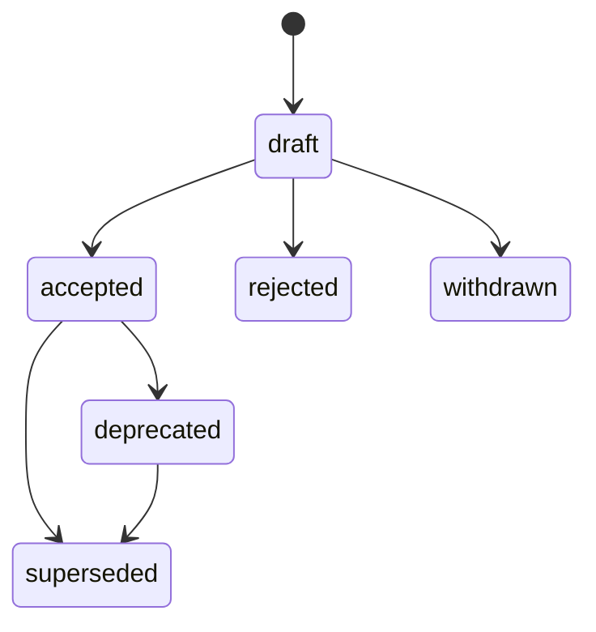

# ADR Suite

This package contains several agent skills for the full Architecture Decision Record lifecycle. Each skill writes or reads project ADRs under `docs/adrs/`.

## Skills

| Skill | Purpose | Typical phase |
| --- | --- | --- |
| `adr-create` | Explore alternatives with the user and create a draft or accepted ADR | Architecture/design |
| `adr-review-spec` | Check a planned feature for conflicts with accepted ADRs | Specification and planning |
| `adr-harvest` | Recover missing decisions from completed features or brownfield code | Post-implementation/baseline |
| `adr-supersede` | Replace an active decision and maintain reciprocal links | Architecture change |
| `adr-transition` | Accept/reject/withdraw/deprecate an ADR using valid transitions | Decision governance |
| `adr-audit` | Validate filenames, metadata, links, statuses, and repository health | CI/maintenance |

An operator may invoke `adr-review-spec` to check a specification for concrete conflicts with scoped accepted ADRs. It does not discover missing ADRs or require new ones. Use `adr-create` when the operator decides to record a new architectural decision. After implementation or final documentation updates, an operator may run `adr-harvest` against an explicit feature or source set to recover durable decisions.


## Canonical convention

- Directory: `docs/adrs/`
- Catalog: `docs/adrs/README.md`
- Filename: `NNNN-short-title.md`, starting with `0001`
- Allocation: highest existing number plus one; gaps are never reused
- Stable ID: `ADR-NNNN`, where `NNNN` is the ADR number in its H1, filename, and frontmatter; for example, `ADR-0001`
- Stable identity: existing ADR files and their IDs are never renumbered and normally never renamed
- Statuses: `draft`, `accepted`, `rejected`, `withdrawn`, `deprecated`, `superseded`
- ADR reference direction: an ADR body, including `## Links`, may cite, reference, or link only to ADRs with lower numbers and a `date` not later than its own. The `superseded-by` frontmatter field is the sole exception because it records lifecycle metadata for a replacement.
- Source-document reference direction: a specification, plan, RFC, design note, or other project document from which a project-specific decision is created or harvested links to that ADR. If a living current-state document later adopts a replacement, its governing link moves to the accepted replacement; intentionally historical text may retain the old link. The ADR must not mention, cite, or link back to those source documents, including under `## Links`. This restriction does not prevent links to eligible ADRs or to independent research, implementation, and verification evidence that does not duplicate the project decision.

`docs/adrs/README.md` is the ADR catalog. It has one row for every ADR, sorted by number, with its stable ID, title, status, date, and replacement link. Keep the catalog in a bounded machine-maintained region so surrounding human prose remains intact:

```markdown
<!-- adr-catalog:start -->
| ADR | Status | Date | Superseded by |
| --- | --- | --- | --- |
| [0001-short-title](0001-short-title.md) | accepted | 2026-09-03 | - |
<!-- adr-catalog:end -->
```

Create the file with this region when creating the first ADR. Refresh the region whenever an ADR is created or its status, title, date, or replacement changes. The catalog is the discovery view; ADR frontmatter remains the authoritative record for a decision's full content and lifecycle links. Cite ADRs in documentation and code by stable ID, not by filename or title alone; use a relative Markdown link to the ADR file where links are supported or required.

## Existing ADR discovery

Treat an existing ADR corpus as available only when all of the following are true:

- `docs/adrs/README.md` exists and contains an ADR catalog with ADR links;
- `docs/adrs/` contains at least one ADR file other than `README.md`;
- the catalog identifies the ADR records to inspect.

If any condition is false, do not search for or require existing ADRs. A missing or empty ADR corpus is not a finding by itself. `adr-create` may establish the first ADR and catalog when no ADR files exist. If ADR files exist but the catalog is missing or does not list ADRs, do not inspect those files to reconstruct the corpus; ask the operator before making a change that would depend on their numbering or lifecycle.

When the corpus is available, first read the catalog and list local ADR files, then read only the records needed for the task. Do not search for ADR documents outside `docs/adrs/`. The sole exception is a specific ADR file outside that directory linked directly from `docs/adrs/README.md`; inspect only that linked file. Do not search project-wide architecture documentation, constitutions, or Spec-driven Development context or memory to find ADRs. A document explicitly named by the operator may be source evidence for creating or harvesting a new ADR, but it does not expand ADR discovery.

`cancelled` is deliberately not a canonical status because it hides three different events:

- an undecided proposal was abandoned: `withdrawn`;
- a proposal was considered and declined: `rejected`;
- an accepted decision ceased to govern without a direct replacement: `deprecated`.

If a new ADR directly replaces an old accepted decision, use `superseded` and reciprocal lifecycle metadata.

## Status transitions



Rejected, withdrawn, and superseded ADRs remain as history. Reconsidering one creates a new ADR that links back to the old record rather than reopening it.

## Recommended SDD integration

Project-level instructions may define when to invoke ADR skills, while leaving the framework's official commands and normal context-loading policy unchanged. Add the following policy to the project's agent instructions (for example `AGENTS.md`):

```markdown
## ADR governance

- Cite ADRs in documentation and code as `ADR-NNNN`.
- Keep `docs/adrs/README.md` as the complete ADR catalog with each ADR's current status.
- Treat the product or architecture specification as the plan for the target state.
- Use ADRs as the log of architectural decisions, including their transitions and reasons for choosing them.
- Keep source documents concise: retain the problem and, for accepted applicable decisions, the current result, then link to their ADRs; do not copy ADR rationale, alternatives, consequences, or lifecycle.
- Keep decision provenance one-way: source specifications, plans, RFCs, and design notes link to the resulting ADR; the ADR does not link back to documents from which it was created or harvested.
- Preserve independent normative requirements, contracts, acceptance criteria, and target-state descriptions when shortening source documents. Only decision-record content moves to the ADR.
- Treat `accepted` as a decision status, not proof that the decision has been implemented.
- Use the ADR discovery boundary in this package. Do not search project architecture documents, constitutions, or framework context to locate ADRs.
- If an optional review finds a concrete conflict with an accepted ADR, do not silently proceed: conform the design or use `adr-supersede` with explicit approval.
```
