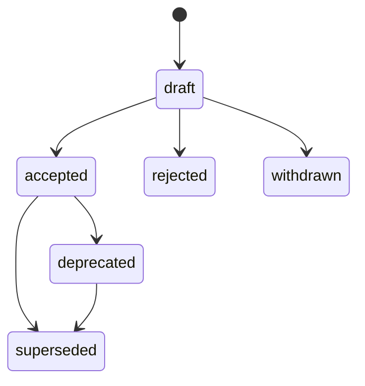

# ADR Suite

This package contains several agent skills for the full Architecture Decision Record lifecycle. Each skill writes or reads project ADRs under `docs/adrs/`.

## Skills

| Skill | Purpose | Typical phase |
| --- | --- | --- |
| `adr-create` | Explore alternatives with the user and create a draft or accepted ADR | Architecture/design |
| `adr-supersede` | Replace an active decision and maintain reciprocal links | Architecture change |
| `adr-transition` | Accept/reject/withdraw/deprecate an ADR using valid transitions | Decision governance |
| `adr-harvest` | Recover missing decisions from completed features or brownfield code | Post-implementation/baseline |
| `adr-review-spec` | Detect conflicts and missing ADRs in a planned feature | Specification and planning |
| `adr-audit` | Validate filenames, metadata, links, statuses, and repository health | CI/maintenance |

## Canonical convention

- Directory: `docs/adrs/`
- Catalog: `docs/adrs/README.md`
- Filename: `NNNN-short-title.md`, starting with `0001`
- Allocation: highest existing number plus one; gaps are never reused
- Stable ID: `ADR-NNNN`, where `NNNN` is the ADR number in its H1, filename, and frontmatter; for example, `ADR-0001`
- Stable identity: existing ADR files and their IDs are never renumbered and normally never renamed
- Statuses: `draft`, `accepted`, `rejected`, `withdrawn`, `deprecated`, `superseded`
- ADR reference direction: an ADR body, including `## Links`, may cite, reference, or link only to ADRs with lower numbers and a `date` not later than its own. The `superseded-by` frontmatter field is the sole exception because it records lifecycle metadata for a replacement.

`docs/adrs/README.md` is the ADR catalog. It has one row for every ADR, sorted by number, with its stable ID, title, status, date, and replacement link. Keep the catalog in a bounded machine-maintained region so surrounding human prose remains intact:

```markdown
<!-- adr-catalog:start -->
| ADR | Status | Date | Superseded by |
| --- | --- | --- | --- |
| [0001-short-title](0001-short-title.md) | accepted | 2026-09-03 | - |
<!-- adr-catalog:end -->
```

Create the file with this region when it is absent. Refresh the region whenever an ADR is created or its status, title, date, or replacement changes. The catalog is the discovery view; ADR frontmatter remains the authoritative record for a decision's full content and lifecycle links. Cite ADRs in documentation and code by stable ID, not by filename or title alone; use a relative Markdown link to the ADR file where links are supported or required.

`cancelled` is deliberately not a canonical status because it hides three different events:

- an undecided proposal was abandoned: `withdrawn`;
- a proposal was considered and declined: `rejected`;
- an accepted decision ceased to govern without a direct replacement: `deprecated`.

If a new ADR directly replaces an old accepted decision, use `superseded` and reciprocal lifecycle metadata.

## Status transitions



Rejected, withdrawn, and superseded ADRs remain as history. Reconsidering one creates a new ADR that links back to the old record rather than reopening it.

## Recommended SDD integration

Skill descriptions enable relevant automatic discovery, especially for `adr-review-spec`, but project-level instructions provide the reliable governance gate. Add the following policy to the project's agent instructions (for example `AGENTS.md`) while leaving the framework's official commands and normal context-loading policy unchanged:

```markdown
## ADR governance

- Cite ADRs in documentation and code as `ADR-NNNN`.
- Keep `docs/adrs/README.md` as the complete ADR catalog with each ADR's current status.
- Treat the product or architecture specification as the plan for the target state.
- Use ADRs as the log of architectural decisions, including their transitions and reasons for choosing them.
- Keep the specification concise: reflect the current result of applicable decisions and link to their ADRs; do not copy ADR rationale or lifecycle.
- Treat `accepted` as a decision status, not proof that the decision has been implemented.
- Assemble deterministic, verifiable LLM context from the specification and its linked ADRs.
- When creating or reviewing a feature specification, architecture plan, or significant technical design, run `adr-review-spec` skill before finalizing it.
- If the review finds an unresolved architectural decision, use `adr-create` skill and link the resulting ADR from the specification or plan.
- If planned work contradicts an accepted ADR, do not silently proceed: conform the design or use `adr-supersede` skill with explicit approval.
- After a feature is implemented or its final documentation is updated, run `adr-harvest` skill to find decisions that escaped registration.
```

Suggested Spec Kit checkpoints:

1. After `/speckit.specify`: review boundaries, contracts, data/security constraints, and conflicts with accepted ADRs.
2. After `/speckit.plan`: review concrete technical commitments and create/supersede ADRs before implementation tasks are finalized.
3. After implementation/final docs: harvest only durable decisions that were actually adopted.
